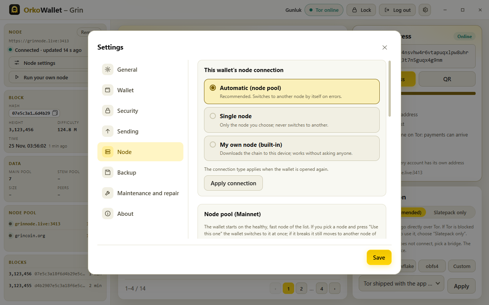

# OrkoWallet – Grin

[](LICENSE)


A desktop wallet for [Grin](https://grin.mw) by Orkoswap. It runs the **official** grin-wallet 5.5.1 and grin 5.5.2 libraries (no re-implemented cryptography), sends and receives over **Tor**, and can run its own node.

<p align="center">
  
</p>

## Download

Get the Windows installer (`OrkoWallet-Grin_0.1.0_x64-setup.exe`) from the [Releases](../../releases) page. It installs per user and needs no administrator rights. Check the SHA-256 listed in the release notes before running it.

## Features

- Tor built in (official Tor 0.4.9, obfs4 / Snowflake / webtunnel bridges). The Tor address matches grin-wallet / Grim for the same seed.
- Pay a Grin address directly over Tor; if the recipient is offline the app retries (default: every minute for 30 minutes) or you can switch to Slatepack.
- Several public nodes with automatic failover and health ordering, or your own built-in node.
- Multiple wallets and accounts, mainnet / testnet, restore from a 24-word phrase, import grin-wallet / Grim folders.
- Screen lock with auto-lock, brute-force throttle, and a recovery-phrase screen that is hidden from screen capture.
- Transaction history with paging, CSV export, wallet backup.
- Interface in six languages: Türkçe, English, Deutsch, Français, Русский, 简体中文.

### Light theme


| | |
|---|---|
|  |  |
|  |  |

### Dark theme

| | |
|---|---|
|  |  |
|  |  |

## Build (Windows)

Requirements: Rust (stable), Node.js, WebView2.

```powershell
pwsh scripts/fetch-tor.ps1                 # verified download of the Tor bundle into vendor/
cd app; npm ci; npx tauri build            # NSIS installer in target/release/bundle/nsis
```

Use `cargo build --locked` so `Cargo.lock` is honoured. `ORKOWALLET_DATA=<dir>` runs a portable copy that never touches the normal data folder.

## Translations

The Turkish source text is the key; `app/ui/i18n.js` holds English, and `app/ui/translations/<code>.json` the other languages. After editing a JSON file run `node scripts/build-lang.js <code>` to regenerate `app/ui/lang-<code>.js`, and `node scripts/check-i18n.js` to verify every key and placeholder. Corrections from native speakers are very welcome.

## Layout

| Path | What |
|---|---|
| `core/` | Wallet core: wraps grin-wallet, Tor manager, node pool with failover, integrated node |
| `app/` | Tauri 2 shell and the user interface (`app/ui`, plain HTML/CSS/JS, no remote content) |
| `scripts/` | Tor bundle download with checksum and signature verification, translation tooling |

## Code signing policy

Release installers are built from this repository by the public GitHub Actions workflow in `.github/workflows/build.yml`. Code signing is not active yet: we plan to use the free signing for open-source projects offered by [SignPath Foundation](https://signpath.org/); until that is approved the installer is unsigned and Windows SmartScreen may warn. Always compare the SHA-256 on the release page with your download.

- Only maintainers of this repository can approve a release for signing.
- The wallet does not collect or send telemetry; network access is limited to the Grin nodes you choose and Tor.

## Security

See [SECURITY.md](SECURITY.md) for the threat model and how to report a vulnerability. This wallet has not had an independent audit; use it with amounts you can afford to lose.

## License

Apache-2.0, see [LICENSE](LICENSE).
