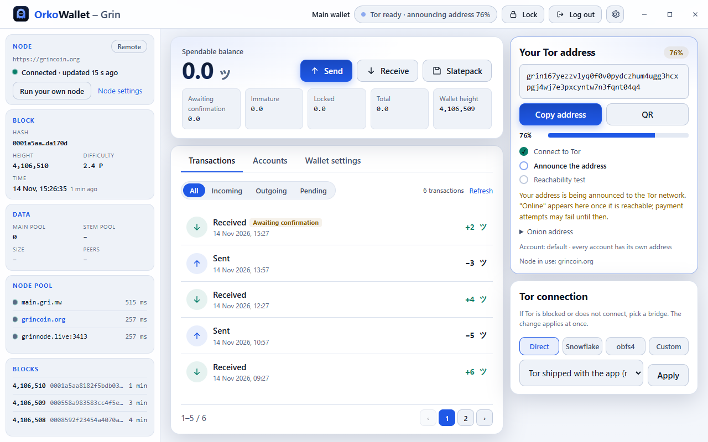
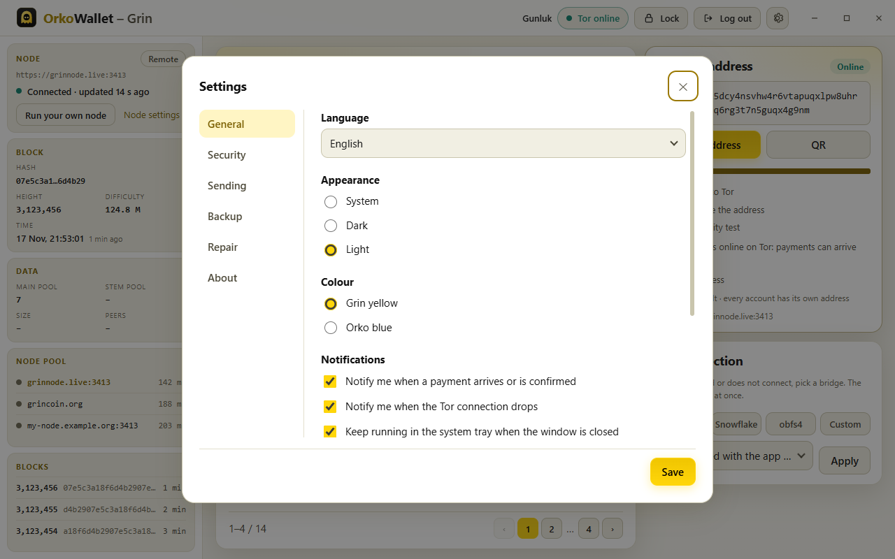

<h1 align="center">OrkoWallet – Grin</h1>

<p align="center">
  A private, open-source desktop wallet for <a href="https://grin.mw">Grin</a>.<br>
  Tor is built in. No account, no tracking, no middleman.
</p>

<p align="center">
  <a href="../../releases"></a>
  <a href="LICENSE"></a>
  
  
  <a href="../../actions/workflows/build.yml"></a>
</p>

<p align="center">
  
</p>

---

## Contents

- [Why OrkoWallet](#why-orkowallet)
- [Features](#features)
- [Screenshots](#screenshots)
- [Install](#install)
- [Troubleshooting](#troubleshooting)
- [Security and privacy](#security-and-privacy)
- [Build from source](#build-from-source)
- [Project layout](#project-layout)
- [Translations](#translations)
- [Contributing](#contributing)
- [About Orkoswap](#about-orkoswap)
- [Donate](#donate)
- [Code signing policy](#code-signing-policy)
- [License](#license)

## Why OrkoWallet

Grin is built for privacy, and a wallet should not weaken that. OrkoWallet runs the **official** grin-wallet 5.5.1 and grin 5.5.2 libraries, so there is no re-implemented cryptography to trust, and it sends and receives over **Tor** out of the box. Your Tor address is the same one grin-wallet and Grim derive from the same seed.

It is meant to be easy for people who are not experts: a clear first-run flow, plain-language messages, and defaults that favour safety.

## Features

Items marked *(next release)* are in the main branch but not in the 0.1.1 installer yet.

**Privacy and networking**

- Tor built in (official Tor 0.4.9, obfs4, Snowflake and webtunnel bridges). Pay a Grin address directly over Tor.
- If the recipient is offline the wallet retries on its own (default: every minute for 30 minutes), or you can switch to Slatepack.
- A pool of public nodes with automatic failover and health ordering, or your own built-in node.
- *(next release)* A repair option that rebuilds the Tor connection when it will not come up, and an automatic clean restart of Tor when your address stays unreachable.

**Wallet**

- Multiple wallets and accounts, mainnet and testnet.
- Create with a 12- or 24-word recovery phrase; restore from 12 to 24 words; import grin-wallet and Grim folders.
- **Max** button to send the whole spendable balance, and a setting for how many confirmations (1 to 10) a payment needs before you can spend it.
- Slatepack send and receive.
- *(next release)* An unfinished Slatepack exchange is kept: open the transaction later to copy the text again, or paste the reply and finish.
- Transaction history with paging, CSV export, payment proofs, wallet backup.
- *(next release)* Delete a wallet from the list, even if you forgot its password.

**Security**

- Screen lock with auto-lock, a brute-force throttle on wrong passwords, and a recovery-phrase screen that is hidden from screen capture.
- Strict content security policy; the interface loads no remote content.
- *(next release)* One running copy only, so two instances cannot fight over the same wallet.

**Comfort**

- Light and dark themes, six languages (Türkçe, English, Deutsch, Français, Русский, 简体中文), and live language switching without a restart.

## Screenshots

### Dark theme

| | |
|---|---|
|  |  |
|  |  |

### Light theme


| | |
|---|---|
|  |  |
|  |  |

## Install

### Windows installer

1. Download the installer (`OrkoWallet.-.Grin_<version>_x64-setup.exe`) from the [Releases](../../releases) page.
2. Compare its SHA-256 with the value in the release notes:

   ```powershell
   Get-FileHash .\OrkoWallet.-.Grin_0.1.1_x64-setup.exe -Algorithm SHA256
   ```

3. Run it. It installs for the current user and needs no administrator rights.

The installer is **not code-signed yet**, so Windows SmartScreen may show "Windows protected your PC". That only means the file is new and unsigned. If the SHA-256 matches, choose **More info → Run anyway**. See the [code signing policy](#code-signing-policy).

### winget (planned)

[winget](https://learn.microsoft.com/windows/package-manager/winget/) downloads the installer itself and checks it against the SHA-256 in the package manifest, so no browser download is involved. Installers fetched this way normally do not show the SmartScreen page that a browser download gets, but Windows can still judge a file by reputation, so we cannot promise it never appears.

The package has to be accepted into the [winget community repository](https://github.com/microsoft/winget-pkgs) first. Until then `winget install` will not find OrkoWallet. After it is accepted:

```powershell
winget install Orkoswap.OrkoWalletGrin
```

## Troubleshooting

**The Tor card stays at about 90% and never says "Online".**
The wallet connected to Tor, but your address cannot be reached from outside yet. In order:

1. Wait a few minutes; the first announcement can take 3 to 5 minutes.
2. Make sure the computer clock is correct (Windows *Settings → Time & language → Date & time → Sync now*). A clock that is off by more than a few minutes breaks Tor.
3. Turn a VPN off or on and compare.
4. Pick **Snowflake** (or **obfs4**) in the *Tor connection* card and press **Apply**. This avoids relays that are slow or blocked on your network.
5. *(next release)* Open **Settings → Repair → Reset the connection and restart**. It deletes Tor's saved state (the entry relays it picked and its cache) and restarts the app. Your wallets, recovery phrase and balance are not touched.
6. Allow `tor.exe` and OrkoWallet through your firewall or antivirus.

*(next release)* The wallet also restarts Tor from a clean state on its own, once, if the address has been unreachable for four minutes. While your address is not online you can still send payments, and you can receive with Slatepack.

**"Another Tor process is running with the same data directory".**
Two copies of the app were started. From the next release only one copy can run: opening it a second time brings the first window to the front. With 0.1.1, close every OrkoWallet and `tor.exe` in Task Manager and start again.

**Logs.** *Settings → About → Open the log folder* opens `orkowallet.log`. Please attach the last lines when you report a problem, and remove anything private first.

## Security and privacy

- Wallet and node code come from the official grin and grin-wallet crates; this project adds the interface, the Tor manager and the node pool.
- No telemetry. The app talks only to the Grin nodes you choose and, through Tor, to other wallets.
- Wallet files are encrypted by grin-wallet with your password. The recovery phrase is shown only after you type the password, and the window is hidden from screen capture while it is on screen.
- Report vulnerabilities privately; see [SECURITY.md](SECURITY.md).

> **This wallet has not had an independent security audit.** Use it with amounts you can afford to lose, and always keep your recovery phrase on paper.

## Build from source

Requirements: Windows 10 or 11, [Rust](https://rustup.rs) (stable), Node.js 20+, WebView2.

```powershell
pwsh scripts/fetch-tor.ps1                 # verified download of the Tor bundle into vendor/
cd app; npm ci; npx tauri build            # NSIS installer in target/release/bundle/nsis
```

Use `cargo build --locked` so `Cargo.lock` is honoured. `ORKOWALLET_DATA=<dir>` runs a portable copy that never touches the normal data folder (and may run next to a normal copy).

Release installers are built by the public workflow in [`.github/workflows/build.yml`](.github/workflows/build.yml) when a `v*` tag is pushed.

## Project layout

| Path | What |
|---|---|
| `core/` | Wallet core: wraps grin-wallet, Tor manager, node pool with failover, integrated node |
| `app/` | Tauri 2 shell and the user interface (`app/ui`, plain HTML, CSS and JavaScript, no remote content) |
| `scripts/` | Tor bundle download with checksum and signature verification, translation tooling |
| `docs/` | Screenshots |

## Translations

The Turkish source text is the key; `app/ui/i18n.js` holds English and `app/ui/translations/<code>.json` the other languages. After editing a JSON file run `node scripts/build-lang.js <code>` to regenerate `app/ui/lang-<code>.js`, then `node scripts/check-i18n.js` to verify every key and placeholder. Corrections from native speakers are very welcome, and so are new languages.

## Contributing

Bug reports, fixes, translations and ideas are welcome. Please read [CONTRIBUTING.md](CONTRIBUTING.md) first. For security problems use [SECURITY.md](SECURITY.md), not a public issue.

## About Orkoswap

Orkoswap is a community-driven project that puts privacy first. We build the tools we want to use ourselves, we keep them free and open source, and we are not here to chase investors: no pitch decks, no funding rounds, just software that respects the people using it. OrkoWallet is part of that. If it helps you, tell others, report bugs, translate it, or [donate](#donate).

**Planned:** Orkoswap deposits and withdrawals from inside the wallet, and a mobile version.

## Donate

OrkoWallet is free. If you want to support its development, send Grin to our always-online address (also available in the app under *Settings → About → Donate*):

```
grin1tzlscdyzl0pgns8rw9sl7q9wqptftjez2xsdrszj9se4vmvwj8wqajj4yz
```

## Code signing policy

Release installers are built from this repository by the public GitHub Actions workflow in `.github/workflows/build.yml`. Code signing is not active yet: we plan to use the free signing for open-source projects offered by [SignPath Foundation](https://signpath.org/); until that is approved the installer is unsigned and Windows SmartScreen may warn. Always compare the SHA-256 on the release page with your download.

- Only maintainers of this repository can approve a release for signing.
- The wallet does not collect or send telemetry; network access is limited to the Grin nodes you choose and Tor.

## License

Apache-2.0, see [LICENSE](LICENSE). The names "OrkoWallet" and "Orkoswap" are not covered by the license.
