<p align="center">
  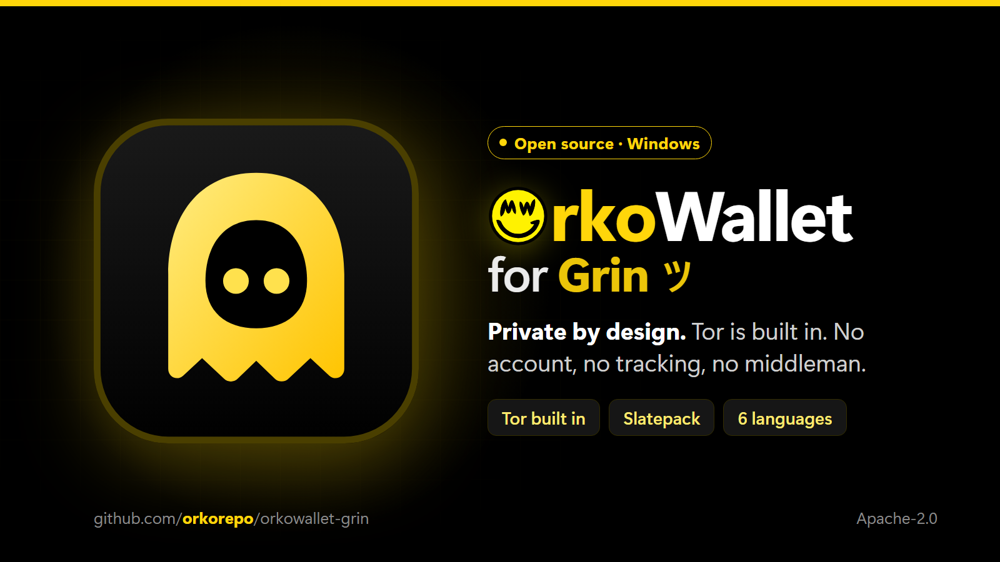
</p>

<h1 align="center">OrkoWallet – Grin</h1>

<p align="center">
  <b>A private, open-source wallet for <a href="https://grin.mw">Grin</a></b><br>
  on Windows · Linux · Android<br>
  <sub>Tor is built in. No account, no tracking, no middleman. Free, and made by the community for the community.</sub>
</p>

<p align="center">
  <a href="../../releases/latest"><b>⬇️ Download</b></a> &nbsp;·&nbsp;
  <a href="#whats-new">✨ What's new</a> &nbsp;·&nbsp;
  <a href="#install">📖 Install</a> &nbsp;·&nbsp;
  <a href="https://t.me/chat_orko"><b>💬 Feedback on Telegram</b></a>
</p>

<p align="center">
  <a href="../../releases"></a>
  <a href="LICENSE"></a>
  
  
  <a href="../../actions/workflows/build.yml"></a>
  <a href="https://t.me/chat_orko"></a>
</p>

<p align="center">
  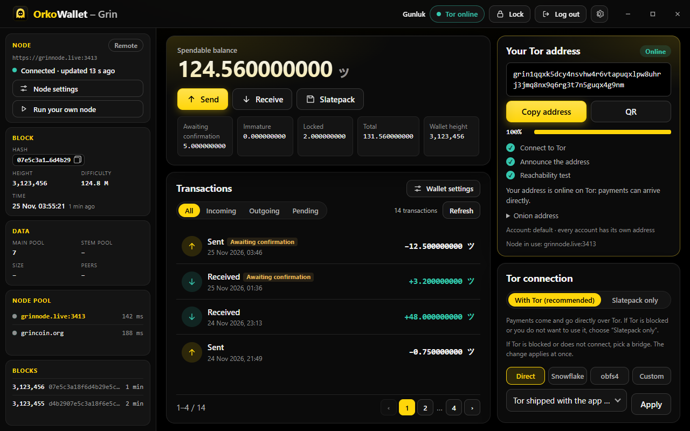
</p>

---

<a id="download"></a>

## ⬇️ Download

Get the file for your system from the **[latest release](../../releases/latest)**, check it against `SHA256SUMS.txt`, install. Every file has the same name pattern: `OrkoWallet-<version>-<system>-<arch>.<ext>`.

| | System | File | Status |
|:-:|---|---|:-:|
| 🪟 | **Windows** 10 / 11 | `…-windows-x64-setup.exe` (installer) · `…-windows-x64-portable.zip` | ✅ tested |
| 🤖 | **Android** 7+ (arm64) | `…-android-arm64.apk` | ✅ tested |
| 🐧 | **Linux** Debian, Ubuntu, Mint | `…-linux-amd64.deb` | 🧪 new |
| 🐧 | **Linux** Fedora, openSUSE | `…-linux-x86_64.rpm` | 🧪 new |
| 🐧 | **Linux** any distribution | `…-linux-x86_64.AppImage` · `…-linux-x86_64.tar.gz` | 🧪 new |
| 📦 | Source code | `…-source.zip` | |

> **🧪 Linux is new.** It builds and packages cleanly, but we have not been able to try it on many real machines yet. If something does not work (Tor does not connect, the window does not open, a button does nothing), **please tell us: [t.me/chat_orko](https://t.me/chat_orko)**. Your feedback is what makes this build good, and we answer.

---

<a id="whats-new"></a>

## ✨ What's new in 0.3.2: the big update

> The largest release so far. One settings window instead of three, a phone app that finally feels at home, a Linux build, and a wallet that understands being used on more than one device.

| | |
|---|---|
| 🗂️ **One Settings window, eight clear categories** | General, Wallet, Security, Sending, Node, Backup, Maintenance and repair, About: the same on the desktop and the phone. On the phone it opens as a list, a tap opens a category. |
| 🐧 **Linux** | `.deb`, `.rpm`, `.AppImage` and `.tar.gz` next to the Windows installer, built by the same public workflow. Same features on every desktop. |
| 📴 **Slatepack only mode** | Switch Tor off completely: payments go and come as Slatepack texts. One tap, applies at once. |
| 📱 **A better phone app** | Every page scrolls to the end, pull down to refresh, a scroll button, larger buttons in the node panel, and **Close wallet** right in the notification. |
| 🔁 **Same wallet on two devices** | Money spent on another device now shows as "Spent on another device", the change is found by a short scan, and a note explains how to use two devices safely. |
| ⚡ **Instant Max** | The Max amount is ready the moment the Send window opens. |
| 🧹 **Tidy accounts** | Remove an account from the list (it is only hidden; its money and address stay). Deleting a wallet stays a separate step with its own confirmation. |
| 🔎 **Kernel link on Android**, **rescan from this year by default**, and many small fixes. | |

See the [changelog](CHANGELOG.md) for every detail.

## Contents

- [Download](#download)
- [What's new in 0.3.2](#whats-new)
- [Why OrkoWallet](#why-orkowallet)
- [Features](#features)
- [Screenshots](#screenshots)
- [Install](#install)
- [Troubleshooting](#troubleshooting)
- [Security and privacy](#security-and-privacy)
- [Build from source](#build-from-source)
- [Project layout](#project-layout)
- [Translations](#translations)
- [Feedback and community](#feedback)
- [Contributing](#contributing)
- [About Orkoswap](#about-orkoswap)
- [Donate](#donate)
- [Code signing policy](#code-signing-policy)
- [License](#license)

## Why OrkoWallet

Grin is built for privacy, and a wallet should not weaken that. OrkoWallet runs the **official** grin-wallet 5.5.1 and grin 5.5.2 libraries, so there is no re-implemented cryptography to trust, and it sends and receives over **Tor** out of the box. Your Tor address is the same one grin-wallet and Grim derive from the same seed.

It is meant to be easy for people who are not experts: a clear first-run flow, plain-language messages, and defaults that favour safety.

## Features

**Privacy and networking**

- Tor built in (official Tor 0.4.9, obfs4, Snowflake and webtunnel bridges). Pay a Grin address directly over Tor.
- **Slatepack only mode**: switch Tor off entirely (*Settings → General → Connection mode*, or the Tor card) and pay with Slatepack texts.
- If the recipient is offline the wallet retries on its own (default: every minute for 30 minutes), or you can switch to Slatepack.
- A pool of public nodes with automatic failover and health ordering, or your own built-in node.
- A connection diagnosis that finds out why Tor will not connect (internet, clock, blocked network, log), and a repair option that rebuilds the Tor connection when it will not come up, and an automatic clean restart of Tor when your address stays unreachable.

**Wallet**

- Multiple wallets and accounts, mainnet and testnet. Accounts you no longer need can be removed from the list (only hidden, nothing is lost).
- The same wallet on two devices: money the other device spent appears as **Spent on another device**, and the change is found automatically.
- Create with a 12- or 24-word recovery phrase; restore from 12 to 24 words; import grin-wallet and Grim folders.
- **Show your recovery phrase again** under *Settings → Backup*: it asks for your password first, warns you, and hides the words from screenshots and screen recording while they are visible.
- **Max** button to send the whole spendable balance, and a setting for how many confirmations (1 to 10) a payment needs before you can spend it.
- Slatepack send and receive.
- An unfinished Slatepack exchange is kept: open the transaction later to copy the text again, or paste the reply and finish.
- Transaction history with paging, CSV export, payment proofs, wallet backup.
- Delete a wallet from the list, even if you forgot its password. It asks for confirmation first, and the encrypted key file stays for 30 days under "Recently deleted", so a mistake can be undone.
- **Repair (rescan)** starts from the current year by default, the fastest choice; "from the start" is still there.

**Stay informed**

- Desktop notifications when a payment arrives or is confirmed, and when your Tor address stops answering (and when it is back). Each one can be switched off in *Settings → General*; amounts are left out while the wallet is locked.
- The close button hides the window to the system tray instead of quitting, so the wallet keeps receiving and notifying. Right-click the tray icon to quit; this can be switched off.
- Open a transaction's kernel in the [Grin Scan](https://scan.grin.money) block explorer with one click (mainnet).

**Security**

- Screen lock with auto-lock, a brute-force throttle on wrong passwords, and a recovery-phrase screen that is hidden from screen capture.
- Strict content security policy; the interface loads no remote content.
- One running copy only, so two instances cannot fight over the same wallet.

**Android**

- The same wallet as an Android app (arm64, Android 7 and newer) with Tor built in, so you send and receive over Tor on your phone too.
- Keeps receiving with the screen off: while a wallet is open a small ongoing notification ("OrkoWallet is running") keeps the app and its Tor address alive, even in Android's deep sleep. The Back button sends the app to the background; logging out of the wallet stops it.
- Payment and Tor notifications, and a screen that cannot be captured while the recovery phrase is visible.
- **Close wallet** in the ongoing notification shuts the wallet and Tor down cleanly and quits the app.
- Pull down to refresh, pages that always scroll to the end, and a round scroll button.

**Comfort**

- One **Settings** window with eight categories, identical on every platform.
- Black-and-yellow Grin look by default, with the Orko blue as a second colour set (*Settings → General → Colour*), each in a light and a dark theme.
- Six languages (Türkçe, English, Deutsch, Français, Русский, 简体中文), and live language switching without a restart.
- Opens at a modest size and shrinks to a compact, single-column layout with bottom tabs, so it fits small windows; the Android app uses the same layout.

## Screenshots

### Dark theme

| | |
|---|---|
| 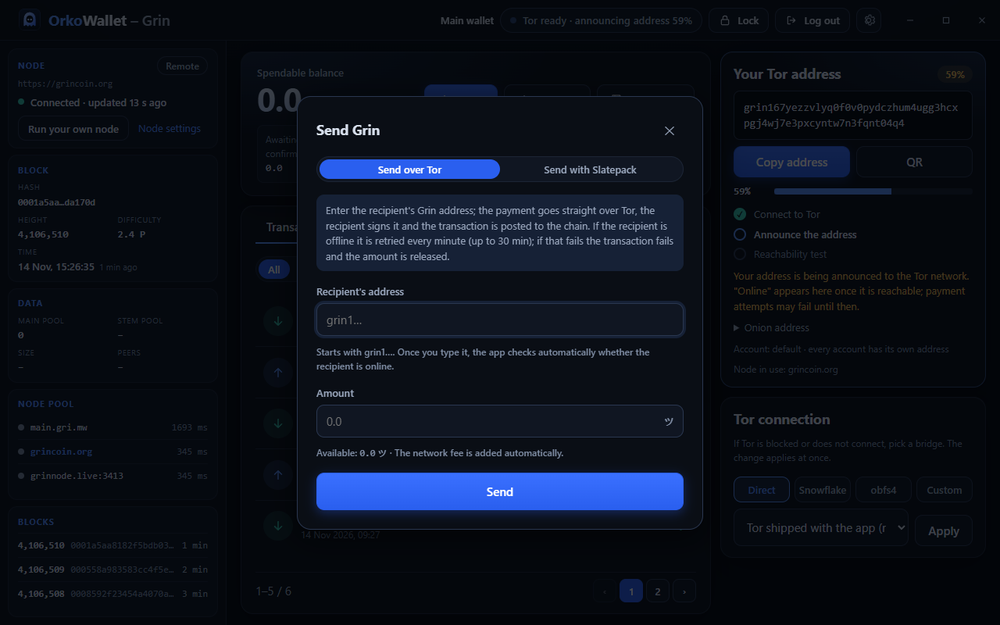 | 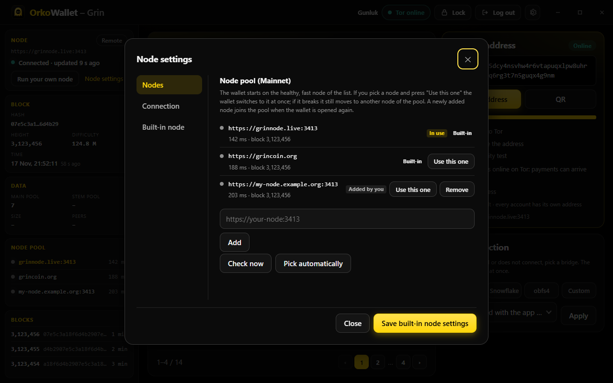 |
| 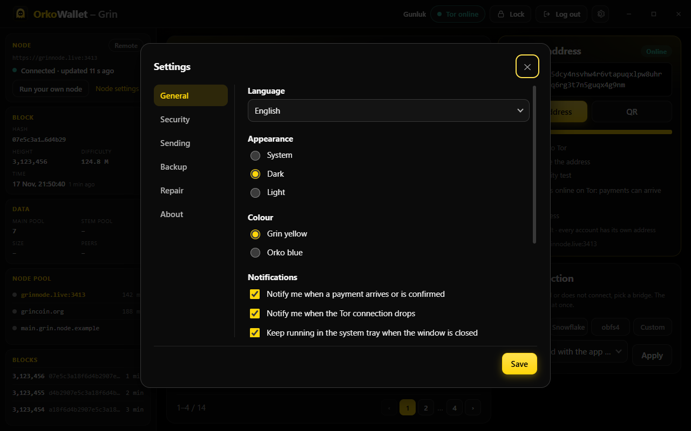 |  |

### Light theme

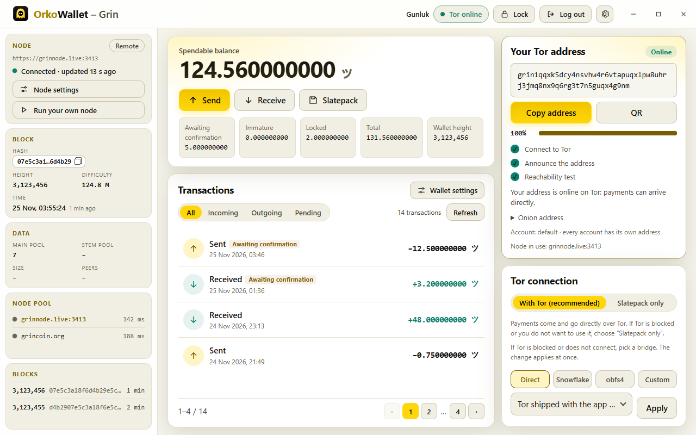

| | |
|---|---|
| 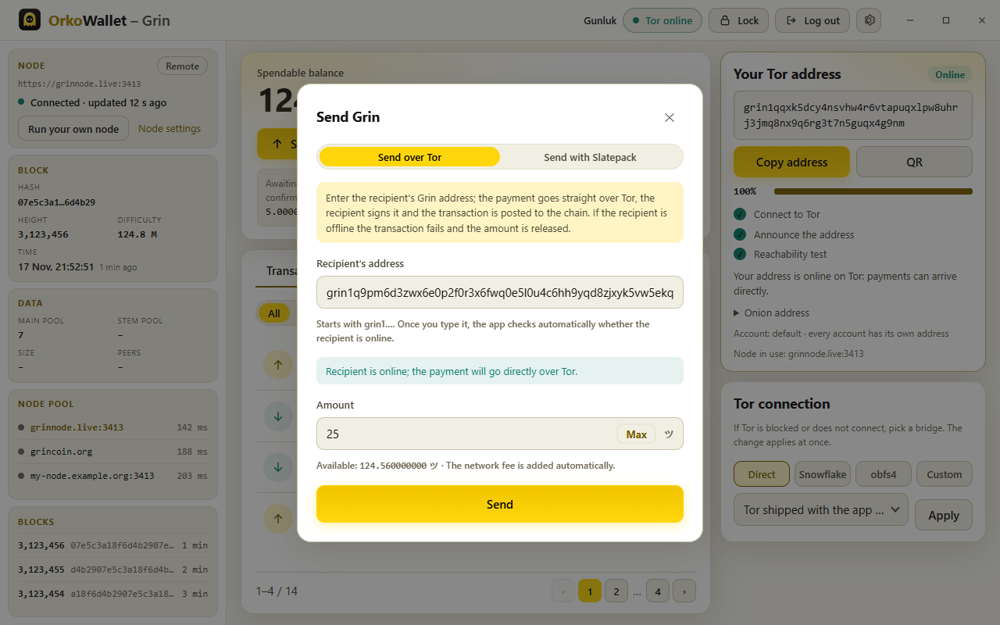 |  |
|  | 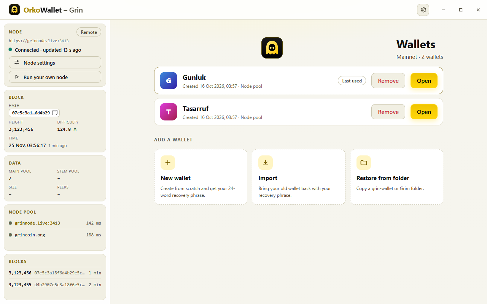 |

### Two colour sets

The default is the black-and-yellow Grin look. Prefer the blue Orko colours? Pick them under *Settings → General → Colour*; the change shows at once and is remembered. Both sets come in a light and a dark theme.

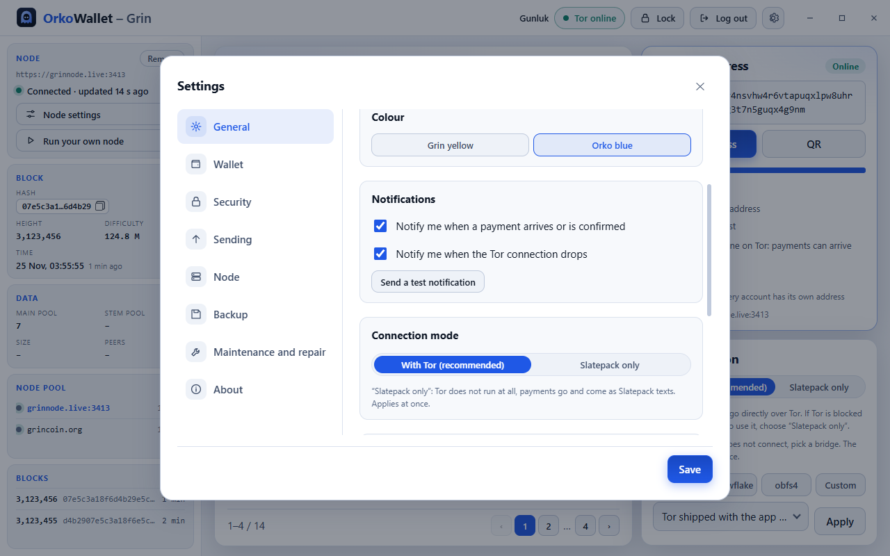

| Orko blue, dark | Orko blue, light |
|---|---|
| 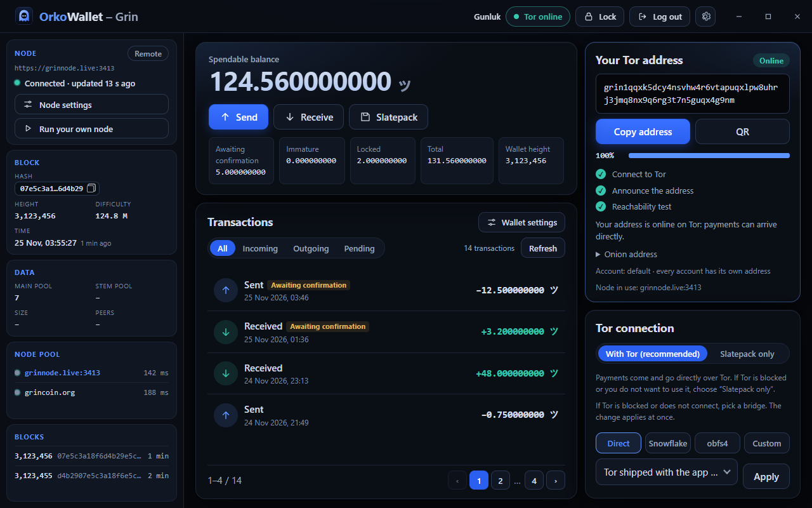 | 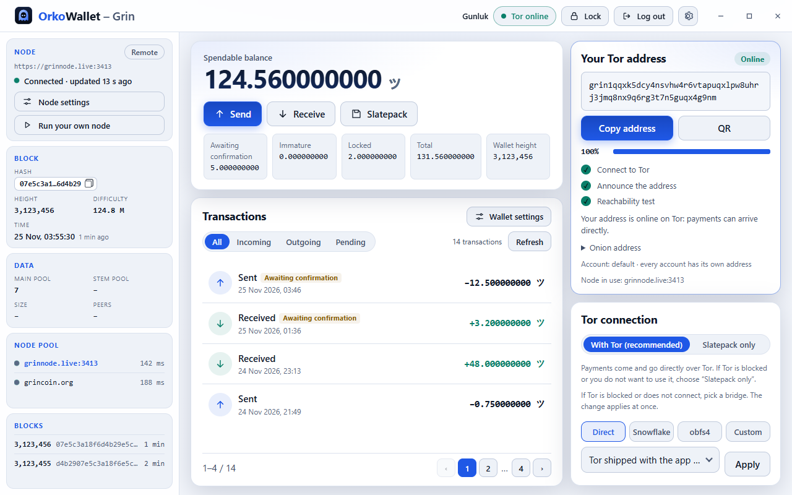 |

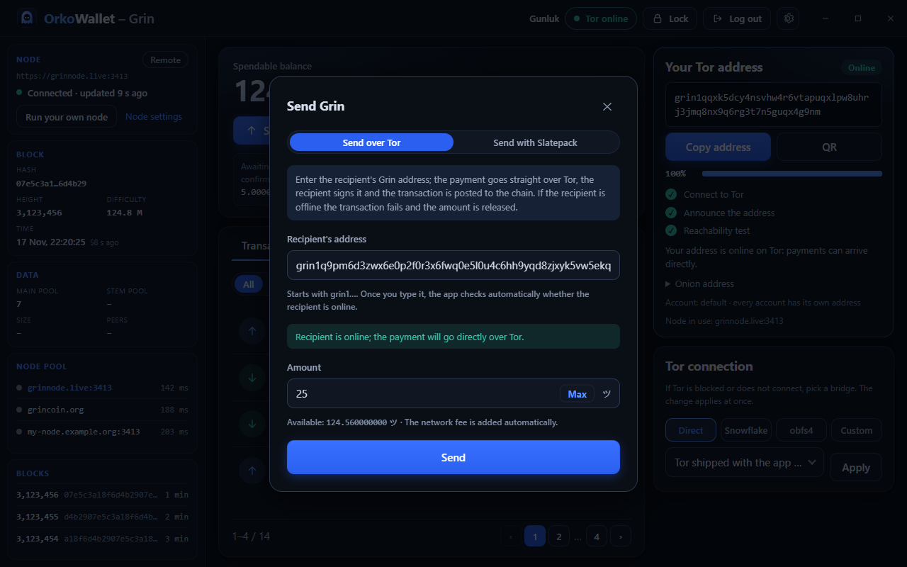

### Compact layout

The same wallet in a narrow window or on a phone-sized screen: one column, bottom tabs for Wallet, Tor and Node.

<p>
  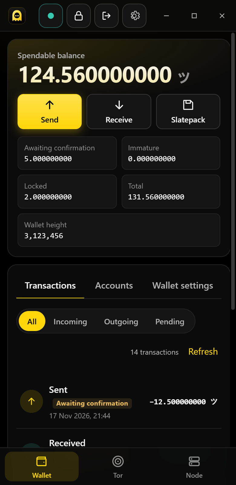
  &nbsp;
  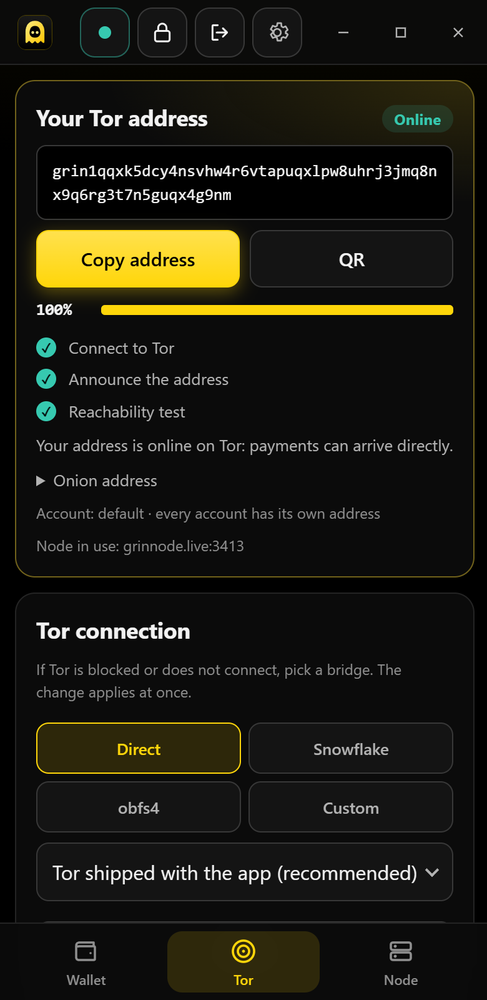
</p>

### Android

<p>
  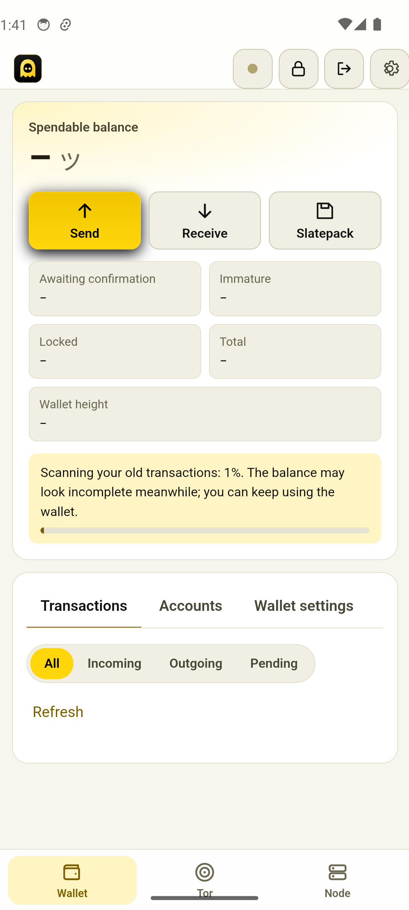
  &nbsp;
  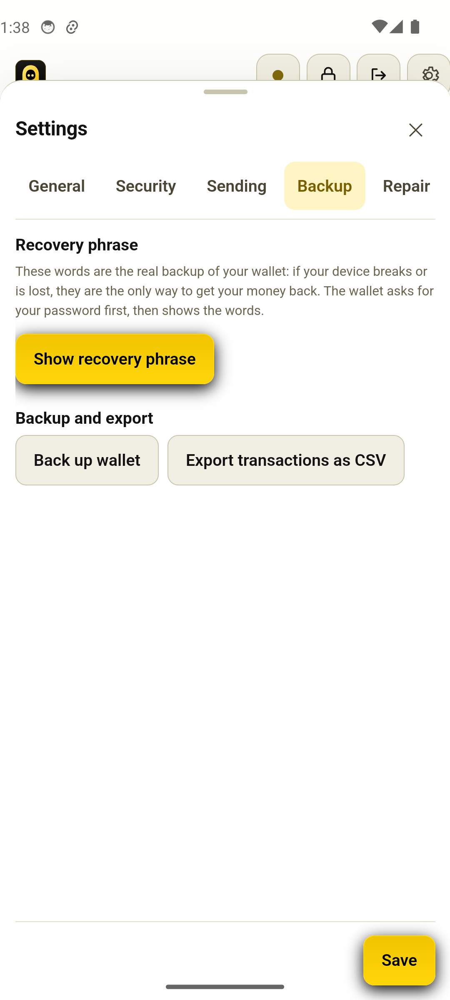
</p>

> The screenshots show demo data or an empty test wallet, not a real wallet.

## Install

### Windows installer

1. Download the installer (`OrkoWallet-<version>-windows-x64-setup.exe`) from the [Releases](../../releases) page. No installation wanted? `OrkoWallet-<version>-windows-x64-portable.zip` runs from any folder.
2. Compare its SHA-256 with the value in the release notes:

   ```powershell
   Get-FileHash .\OrkoWallet-0.3.2-windows-x64-setup.exe -Algorithm SHA256
   ```

3. Run it. It installs for the current user and needs no administrator rights.

On the first start Windows may ask you to confirm the new installer ("Windows protected your PC": choose **More info → Run anyway**). Compare the SHA-256 first, as above. We are applying for free open-source code signing; see the [code signing policy](#code-signing-policy).

### Linux

Download one of these from the [Releases](../../releases) page and compare its SHA-256 with `SHA256SUMS.txt` (`sha256sum <file>`):

- **`.deb`** (Debian, Ubuntu, Mint and friends): `sudo apt install ./OrkoWallet*.deb`
- **`.AppImage`** (any distribution): `chmod +x OrkoWallet*.AppImage` and run it.

Tor is included, nothing else to install. The tray icon needs an AppIndicator-capable desktop (GNOME needs the *AppIndicator* extension). Prefer no installation? The `.tar.gz` holds the program with its Tor folder next to it: unpack and run `orkowallet`.

🧪 *New in 0.3.2 and not yet tried on many machines. Does it work for you? Tell us at [t.me/chat_orko](https://t.me/chat_orko).*

### Android

1. Download `OrkoWallet-<version>-android-arm64.apk` from the [Releases](../../releases) page on your phone.
2. Compare its SHA-256 with the value in the release notes (on a computer: `Get-FileHash .\OrkoWallet-0.3.2-android-arm64.apk -Algorithm SHA256`, or `sha256sum` on Linux).
3. Open the file. Android asks you to allow installing apps from this source (your browser or file manager); allow it for this one install.
4. When you open a wallet for the first time, allow notifications. The "OrkoWallet is running" notification is what keeps your Tor address online in the background, so please leave it alone.

The APK is signed with the project's own release key (the same key for every release, so updates install over each other). It is **not** in the Google Play Store. Some phone makers (Xiaomi, Samsung, Huawei and others) stop background apps to save battery; if payments only arrive while the app is open, set the battery use of OrkoWallet to *Unrestricted* in the phone's app settings. If you swipe the app away from the recent apps list, Android stops it and the wallet no longer receives until you open it again.

### winget (planned)

[winget](https://learn.microsoft.com/windows/package-manager/winget/) downloads the installer itself and checks it against the SHA-256 in the package manifest, so no browser download is involved. Installers fetched this way normally do not show the SmartScreen page that a browser download gets, but Windows can still judge a file by reputation, so we cannot promise it never appears.

The package has to be accepted into the [winget community repository](https://github.com/microsoft/winget-pkgs) first. Until then `winget install` will not find OrkoWallet. After it is accepted:

```powershell
winget install Orkoswap.OrkoWalletGrin
```

## Troubleshooting

**The Tor card stays at about 90% and never says "Online".**
The wallet connected to Tor, but your address cannot be reached from outside yet. In order:

1. Open **Settings → Maintenance and repair → Run the diagnosis**. It checks your internet, the computer clock, whether your network blocks Tor and the Tor log, and tells you what to try next.
2. Wait a few minutes; the first announcement can take 3 to 5 minutes.
3. Make sure the computer clock is correct (Windows *Settings → Time & language → Date & time → Sync now*). A clock that is off by more than a few minutes breaks Tor.
4. Turn a VPN off or on and compare.
5. Pick **Snowflake** (or **obfs4**) in the *Tor connection* card and press **Apply**. This avoids relays that are slow or blocked on your network.
6. Open **Settings → Maintenance and repair → Reset the connection and restart**. It deletes Tor's saved state (the entry relays it picked and its cache) and restarts the app. Your wallets, recovery phrase and balance are not touched.
7. Allow `tor.exe` (`tor` on Linux) and OrkoWallet through your firewall or antivirus.
8. Tor blocked where you are, or you simply do not want it? Switch to **Slatepack only** (*Settings → General → Connection mode*).

The wallet also restarts Tor from a clean state on its own, once, if the address has been unreachable for four minutes. While your address is not online you can still send payments, and you can receive with Slatepack.

**"Another Tor process is running with the same data directory".**
Two copies of the app were started. Since 0.1.2 only one copy can run: opening it a second time brings the first window to the front. With 0.1.1, close every OrkoWallet and `tor.exe` in Task Manager and start again.

**Android: payments only arrive while the app is open.** Check that the "OrkoWallet is running" notification is there (allow notifications for the app), that the wallet is open (not logged out) and that the battery use of OrkoWallet is *Unrestricted*. Do not swipe the app away from the recent apps list; use the Back button to leave it running in the background.

**Android: the app closes and does not come back after changing the network.** Fixed in 0.3.2; the app now starts again by itself.

**Still stuck?** Ask in the chat: [t.me/chat_orko](https://t.me/chat_orko).

**Logs.** *Settings → About → Open the log folder* opens `orkowallet.log` (desktop). Please attach the last lines when you report a problem, and remove anything private first.

## Security and privacy

- Wallet and node code come from the official grin and grin-wallet crates; this project adds the interface, the Tor manager and the node pool.
- No telemetry. The app talks only to the Grin nodes you choose and, through Tor, to other wallets.
- Wallet files are encrypted by grin-wallet with your password. The recovery phrase is shown only after you type the password, and the window is hidden from screen capture while it is on screen (on Android the screen is protected against screenshots and screen recording at that moment).
- Report vulnerabilities privately; see [SECURITY.md](SECURITY.md).

> **Open to review.** The code is public and built on the official grin and grin-wallet libraries; an independent audit is still ahead of us, and reviews from the community are very welcome. As with every wallet, keep your recovery phrase on paper.

## Build from source

Requirements: [Rust](https://rustup.rs) (stable), Node.js 20+, PowerShell 7 (`pwsh`, also on Linux) and:

- **Windows** 10 or 11 with WebView2.
- **Linux**: `libwebkit2gtk-4.1-dev libayatana-appindicator3-dev librsvg2-dev libssl-dev pkg-config clang build-essential` (Debian/Ubuntu names) and `gpg`.

```sh
pwsh scripts/fetch-tor.ps1 -Platform windows-x86_64   # or linux-x86_64
cd app && npm ci && npx tauri build                   # Windows: --bundles nsis · Linux: --bundles deb,appimage
```

The Tor bundle comes from the Tor Project's permanent archive. Its SHA-256 is pinned (Windows) or taken from the Tor Project's signed hash list, whose GPG signature must verify (Linux).

Use `cargo build --locked` so `Cargo.lock` is honoured. `ORKOWALLET_DATA=<dir>` runs a portable copy that never touches the normal data folder (and may run next to a normal copy).

Release files for Windows and Linux are built by the public workflow in [`.github/workflows/build.yml`](.github/workflows/build.yml) when a `v*` tag is pushed; "Run workflow" builds them without publishing.

### Android

Requirements: JDK 17, the Android SDK (platform 34 or newer, NDK 26.3), Rust with the Android targets (`rustup target add aarch64-linux-android`), Node.js 20+ and Python 3.

```sh
python scripts/fetch-tor-android.py         # Tor for Android, SHA-256 checked, into the Android project
cd app && npm ci
npx tauri android build --target aarch64 --apk
# -> app/src-tauri/gen/android/app/build/outputs/apk/universal/release/app-universal-release.apk
```

Add `--debug` for a debug build. A release build is signed with the key named in `~/.orko-signing/keystore.properties` (or the file in `ORKO_KEYSTORE_PROPS`; it holds `storeFile`, `storePassword`, `keyAlias`, `keyPassword`); without one the APK is unsigned. Building from Windows needs a few extra steps, see [docs/ANDROID.md](docs/ANDROID.md).

## Project layout

| Path | What |
|---|---|
| `core/` | Wallet core: wraps grin-wallet, Tor manager, node pool with failover, integrated node |
| `app/` | Tauri 2 shell and the user interface (`app/ui`, plain HTML, CSS and JavaScript, no remote content) |
| `app/src-tauri/gen/android/` | Android project (Gradle, the foreground service `OrkoService.kt`, the activity bridge); the Tor binaries for it are fetched by `scripts/fetch-tor-android.py` |
| `vendor/patches/` | A one-line fix for the `lmdb-master-sys` build script so it cross-compiles for Android |
| `scripts/` | Tor bundle download with checksum and signature verification (Windows, Linux and Android), translation tooling |
| `docs/` | Banner, logo and screenshots |

## Translations

The Turkish source text is the key; `app/ui/i18n.js` holds English and `app/ui/translations/<code>.json` the other languages. After editing a JSON file run `node scripts/build-lang.js <code>` to regenerate `app/ui/lang-<code>.js`, then `node scripts/check-i18n.js` to verify every key and placeholder. Corrections from native speakers are very welcome, and so are new languages.

<a id="feedback"></a>

## 💬 Feedback and community

Your feedback matters to us: a bug, something confusing, an idea, a translation fix, or just "it works on my Fedora". Write to us in the community chat:

<p align="center">
  <a href="https://t.me/chat_orko"></a>
</p>

- **Quick question or "does this work for you?"** → the Telegram chat.
- **A clear bug or a feature idea** → a [GitHub issue](../../issues/new/choose) (templates included), so it does not get lost.
- **A security problem** → privately, see [SECURITY.md](SECURITY.md). Never post a recovery phrase, a password or a wallet file anywhere.

When you report a problem please add your system (Windows, Linux distribution, Android model), the OrkoWallet version (*Settings → About*) and the last lines of `orkowallet.log` (*Settings → About → Open the log folder*), with anything private removed.

## Contributing

Bug reports, fixes, translations and ideas are welcome. Please read [CONTRIBUTING.md](CONTRIBUTING.md) first. For security problems use [SECURITY.md](SECURITY.md), not a public issue.

## About Orkoswap

Orkoswap is a community-driven project that puts privacy first. We build the tools we want to use ourselves, we keep them free and open source, and we are not here to chase investors: no pitch decks, no funding rounds, just software that respects the people using it. OrkoWallet is part of that. If it helps you, tell others, report bugs, translate it, or [donate](#donate).

**Planned:** Orkoswap deposits and withdrawals from inside the wallet.

## Donate

OrkoWallet is free, has no income and no ads. If you want to support its development, send Grin to our always-online address (also available in the app under *Settings → About → Donate*):

```
grin1tzlscdyzl0pgns8rw9sl7q9wqptftjez2xsdrszj9se4vmvwj8wqajj4yz
```

## Code signing policy

Release files for Windows and Linux are built from this repository by the public GitHub Actions workflow in `.github/workflows/build.yml`, and `SHA256SUMS.txt` lists the hash of every file. The Android APK is built on a maintainer's machine from the same sources and signed with the project's release key; its SHA-256 is on the release page. We are applying for the free code signing for open-source projects offered by [SignPath Foundation](https://signpath.org/). Until then, compare the SHA-256 on the release page with your download; Windows may ask you to confirm the first start.

- Only maintainers of this repository can approve a release for signing.
- The wallet does not collect or send telemetry; network access is limited to the Grin nodes you choose and Tor.

## License

Apache-2.0, see [LICENSE](LICENSE). The names "OrkoWallet" and "Orkoswap" are not covered by the license.
